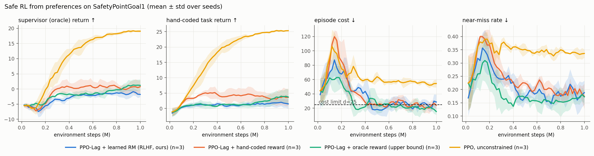
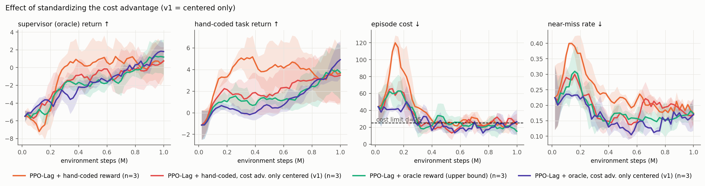
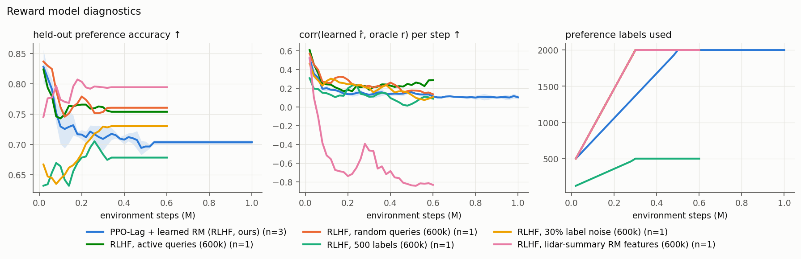
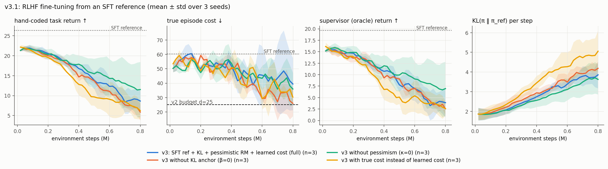
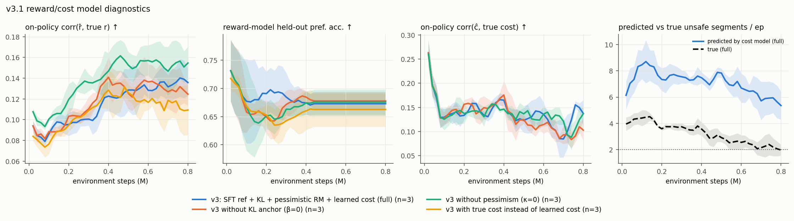

# Safe RL from Human Preferences: Constrained (Hierarchical) Policy Optimization with Learned Reward Models

A from-scratch PyTorch implementation of **safe reinforcement learning from preference feedback** on the
[Safety-Gymnasium](https://github.com/PKU-Alignment/safety-gymnasium) `SafetyPointGoal1-v0` benchmark:

* **Constrained MDP + Lagrangian relaxation** (PPO-Lagrangian with a separate cost critic, plus a PID-Lagrangian variant)
  enforces the hard rule *"stay out of hazards"* as an expected-cost budget `J_C(π) ≤ d`.
* **RLHF-style reward learning** (Christiano et al., 2017): a Bradley-Terry reward-model ensemble is trained
  online from pairwise preferences over trajectory segments, with ensemble-disagreement active queries and noisy labels.
  It captures a *soft* preference the hand-coded reward lacks: keep a safety margin around hazards.
* **Hierarchical Manager-Worker variant**: a manager proposes egocentric sub-goals every *k* steps, a worker reaches
  them; both levels are Lagrangian-constrained.
* **v3, the LLM recipe**: a behavior-cloned "SFT" reference, PPO fine-tuning with a KL penalty to that reference,
  pessimistic reward/cost ensembles, and a **cost model learned from safety preferences** (Safe-RLHF).

The design mirrors Safe-RLHF (Dai et al., 2024) for LLMs: **hard constraints go into a cost, nuanced preferences
go into a learned reward**, and a Lagrange multiplier arbitrates between them.

### Versions at a glance (full story in [JOURNEY.md](JOURNEY.md))

| Version | Change | Outcome |
|---|---|---|
| v0 | Original prototype (`history/v0_original/`) | Failed review: untrained reward model, single sub-goal, agent never reached the goal |
| v1 | Rebuild on Safety-Gymnasium: PPO-Lag, preference RM, HRL | Constraint met; constrained agents barely learn the task |
| v2 | Standardized cost advantage + ablations + RM diagnostics | Fix within seed noise; found reward-model **overoptimization** |
| v3.0 | SFT reference → RM + learned cost → PPO + KL, pessimism | Pretrained policy barely moved; never became safe |
| v3.1 | v3.0 + plasticity fixes, 800k steps | Cost 60 → 29–43 but capability 26 → 6–12; pessimism-induced λ divergence; segment-level safety labels saturate |

## v2 results: safe RLHF from scratch

1M environment steps per run, 3 seeds for the main conditions. The numbers are the mean ± std over seeds of the
**last 5 training epochs** (100k steps). Full table, including deterministic evaluation on held-out layouts:
[`results/v2/summary.md`](results/v2/summary.md).

| Agent (SafetyPointGoal1, budget d = 25) | Task return ↑ | Episode cost ↓ | Near-miss rate ↓ | Supervisor return ↑ | Goals / ep ↑ |
|---|---|---|---|---|---|
| PPO, unconstrained | **25.2 ± 0.2** | 53.7 ± 1.9 ✗ | 0.34 ± 0.01 | **19.0 ± 0.1** | **11.9** |
| PPO-Lag + hand-coded reward | 3.8 ± 2.8 | 23.6 ± 5.5 ✓ | 0.19 ± 0.03 | 0.8 ± 2.3 | 2.1 |
| PPO-Lag + oracle reward (upper bound) | 3.8 ± 2.3 | **18.5 ± 3.1** ✓ | **0.17 ± 0.02** | 1.2 ± 1.8 | 2.0 |
| **PPO-Lag + learned reward (RLHF, 2000 labels)** | 1.7 ± 1.5 | 25.4 ± 7.6 ≈ | 0.18 ± 0.04 | −1.4 ± 1.0 | 1.1 |
| HRL Manager-Worker + PPO-Lag + RLHF | 1.3 ± 1.0 | 28.3 ± 10.0 ≈ | 0.20 ± 0.01 | −2.1 ± 1.4 | 0.8 |



### Findings

1. **The Lagrangian keeps the agent at the cost budget.** Without a constraint, PPO spends 54 steps per episode inside
   hazards. Every PPO-Lagrangian variant settles at about the budget (18–25), and the near-miss rate falls by about 45% (0.34 → 0.17–0.19).
   This safety is expensive at 1M steps: task return drops from 25 to about 4, and λ climbs to 5–10. That matches the slow reward
   recovery reported for Lagrangian methods in Safety-Gymnasium benchmarks, which train for 10M steps.
2. **RLHF reaches the budget but recovers only part of the task performance.** With 2000 noisy preference labels, the
   learned-reward agent meets the constraint and gets about 45% of the hand-coded agent's task return. The gap comes from the
   reward model: held-out preference accuracy ends at 0.70 (it starts at 0.83), and on a fixed exploration dataset its per-step correlation
   with the hidden reward is 0.39 (0.60 with lidar-summary features). Even a reward regressor trained directly on 20k labeled steps reaches only 0.6
   correlation from raw lidar observations, so the observation space itself limits reward identifiability.
3. **Reward-model overoptimization (Goodhart's law).** The lidar-summary reward model has the *best* held-out preference
   accuracy (0.79). On a fixed exploration dataset it correlates +0.60 per step (+0.70 per segment) with the hidden reward.
   **On the policy's own rollouts, however, its correlation falls from +0.53 at the start to −0.83**: the policy drives itself
   into states where the learned reward is high and the true reward is low. Accuracy on labeled pairs did not detect this,
   because those pairs come from older policies. On-policy correlation, or fresh preference queries, did detect it.
   In every RLHF run the on-policy correlation decays from about 0.6 to about 0.1, a milder form of the same effect.
4. **Hierarchy did not help at this budget.** The Manager-Worker agent keeps cost close to the budget but does not beat the flat
   agent. The GUARD safe-RL benchmark reports the same pattern (hierarchical methods trail Lagrangian ones on navigation).
   Learning with a non-stationary worker and an extra layer of credit assignment costs sample efficiency.
5. **Implementation note: standardizing the cost advantage.** In v1, the cost advantage was only mean-centered, so its raw
   scale (about 10×) dominated `A_R − λA_C`. Standardizing it (as OmniSafe does) improved early learning in some seeds, but
   final metrics are within seed noise (task return 3.8 ± 2.8 vs 3.4 ± 2.5 with the hand-coded reward):
   

### Ablations (1 seed, 600k steps; indicative only)



| Variant | Held-out pref. acc. | On-policy corr(r̂, r) | Task return | Cost |
|---|---|---|---|---|
| Active queries (ensemble disagreement) | 0.75 | 0.27 | −0.3 | 27.5 |
| Random queries | 0.76 | 0.15 | −0.5 | 17.9 |
| 500 labels instead of 2000 | 0.68 | 0.10 | 1.0 | 39.7 |
| 30% label noise | 0.73 | 0.09 | 0.7 | 27.1 |
| Lidar-summary RM features | **0.79** | **−0.82** | 1.2 | 23.6 |

With one seed these differences are within the seed-to-seed spread of the main runs. The only robust signal is the
overoptimization in the summary-feature run. With my untuned gains (K_p = 0.05, K_i = 0.01, K_d = 0.05), the PID-Lagrangian
(`results/v2/lagrangian.png`) made λ oscillate *more* than plain dual ascent (it swings between 1 and 11), because the
proportional term reacts to every noisy single-epoch cost estimate. PID-Lagrangian needs gain tuning or a smoothed cost signal.

### Limitations

* 1M steps and 3 seeds (Safety-Gymnasium reference results use 10M steps and 5+ seeds). The constrained agents have not converged.
* The "human" is a simulated annotator with a known reward and uniform 10% label noise. Real annotators are inconsistent in structured ways.
* The constraint holds in expectation (a Lagrangian bound on average episode cost), not as a hard per-step guarantee.
  Per-step guarantees need a safety filter such as a control barrier function or a shielding layer.
* Ablations use one seed and are indicative only.

## v3 results: the LLM recipe (SFT reference → reward and cost models → PPO + KL)

v3 copies how LLMs are aligned:
1. Behavior-clone a **capable but unsafe** reference π_ref (the "SFT model": return 26.3, cost 60, 12.7 goals per episode).
2. Fine-tune it with PPO-Lagrangian on a **pessimistic** learned reward (`mean − κ·std` of the ensemble), with an
   InstructGPT-style **KL penalty** to π_ref (β = 0.1).
3. Use a **cost model learned from safety preferences** (Safe-RLHF loss: Bradley-Terry + a sign-anchoring
   classification term). The constraint is ≤ 2 unsafe 50-step segments per episode (≈ 22 hazard steps).

Ablations remove one ingredient each: `no_kl` (β = 0), `no_pess` (κ = 0), `true_cost` (constrain the true hazard cost).
v3.0 used default optimizer settings. **v3.1** adds the fixes found by diagnosing v3.0 (policy lr 1e-3, 20 PPO
iterations, exploration reset, faster λ) and trains for 800k steps. 3 seeds each; last 5 epochs:

| v3.1 agent (fine-tuned from π_ref) | Task return ↑ | True cost ↓ | Supervisor return ↑ | Goals / ep | λ (end) | KL to π_ref |
|---|---|---|---|---|---|---|
| SFT reference π_ref (no fine-tuning) | 26.3 ± 0.3 | 60.4 ± 1.8 | 19.7 | 12.7 | – | 0 |
| Full: KL + pessimism + learned cost | 9.1 ± 2.3 | 43.3 ± 21.2 | 4.2 | 4.7 | 99 | 3.8 |
| No KL anchor | 6.4 ± 1.9 | 28.6 ± 10.1 | 2.7 | 3.7 | 92 | 4.2 |
| No pessimism | **11.8 ± 6.4** | 41.2 ± 12.1 | **6.9** | **6.2** | 22 | 3.6 |
| True cost instead of learned cost | 6.8 ± 2.4 | 31.2 ± 3.9 | 3.0 | 3.8 | 39 | 5.0 |
| *(v2, from scratch) PPO-Lag + hand-coded reward* | 3.8 ± 2.8 | 23.6 ± 5.5 | 0.8 | 2.1 | ~8 | – |




### What v3 shows (honest reading)

1. **Fine-tuning a sharp pretrained policy under a constraint is hard (v3.0).** With default settings, the policy barely moved
   (KL to π_ref ≈ 0.25 after 500k steps) and **no variant became safer** (cost 50–57). The causes:
   - The behavior-cloned policy is near-deterministic (action std ≈ 0.3), so it barely explores safer actions.
   - The learned-cost λ was updated in segment units with a step size tuned for hazard steps.
2. **With plasticity restored (v3.1), cost falls but capability falls faster.** Cost drops from 60 to 29–43 and the trend is still
   downward at 800k steps, but task return drops from 26 to 6–12. Every v3.1 variant ends between v2's two endpoints
   (PPO: 25 return at cost 54; PPO-Lag from scratch: 4 return at cost 24), *not* better than both. **None satisfies the
   budget on average.** The best is the true-cost variant at 31 ± 4.
3. **Pessimism on the cost made the constraint infeasible.**
   - The pessimistic cost ensemble (`mean + std`) predicts about 5.7 unsafe segments per episode when only about 2.1 are truly unsafe.
   - λ therefore never stops rising (→ 99) and erodes the reward signal.
   - Without pessimism, the cost model is calibrated (2.3 predicted vs 2.7 true unsafe segments), λ settles at 22, and the agent keeps the most capability (return 11.8).
   - *Lesson:* pessimism adds a bias, and a fixed budget has to account for it.
4. **The segment-level safety label is a proxy that saturates.**
   - Under the learned cost, the number of *truly* unsafe segments falls to about 2 per episode (`full`: 2.1), so the constraint as the annotator expresses it is close to met.
   - True hazard steps are still about 40, because each remaining unsafe segment holds about 15–20 hazard steps, vs about 11 for π_ref.
   - The true-cost control shows the same concentration (1.7 unsafe segments, about 18 hazard steps each), so this is **not** the policy gaming the label. Safer policies simply make fewer but longer incursions.
   - The consequence is still real: a binary "was this clip unsafe?" label stops providing pressure once few clips are unsafe, even though the true cost is far above budget.
   - *Lesson:* the granularity of the human safety judgment caps how safe preference-based constraints can make the policy.
5. **The KL anchor trades safety for retained capability.** `no_kl` ends safer (cost 29 vs 43) but less capable
   (return 6.4 vs 9.1). Anchoring to an *unsafe* reference keeps behavior close to that reference, which is exactly the
   alignment-tax tension in LLM RLHF.
6. **No reward-model overoptimization appeared in v3.** On-policy correlation *rose* in every variant (0.08 → 0.11–0.16),
   so v3 can't show that KL or pessimism *prevent* it. That would need a setting where the unanchored policy actually exploits the reward model (as in v2's summary-feature run).

Full cross-version table: [`results/journey_table.md`](results/journey_table.md). The whole story, with obstacles and
lessons: [`JOURNEY.md`](JOURNEY.md).

## Problem setup

| | |
|---|---|
| Environment | `SafetyPointGoal1-v0`: point robot, 60-D lidar + IMU observation, 2-D continuous action, 1000-step episodes, 8 hazards + 1 vase, goal re-spawns when reached, layout re-randomized every episode |
| Task reward `r_task` | dense progress to goal + 1 per goal reached (hand-coded by the env designer) |
| Cost `c` | 1 for every step spent inside a hazard; budget `d = 25` per episode |
| Hidden supervisor preference | `r_oracle = r_task − α · Σ_h clip((m − d_h)/m, 0, 1)` with margin `m = 0.3 m`, `α = 0.03`; penalizes grazing hazards *outside* the cost region. **Never shown to the agent**; only used to answer preference queries and for evaluation |

### Methods

**PPO-Lagrangian** (`srl/ppo_lag.py`). We solve `min_{λ≥0} max_π J_R(π) − λ (J_C(π) − d)`:
* dual step: `λ ← max(0, λ + η (Ĵ_C − d))` (or PID-Lagrangian, Stooke et al. 2020);
* primal step: PPO-clip on `A = (Â_R − λ Â_C) / (1 + λ)` where `Â_R`, `Â_C` come from separate reward/cost critics with GAE(γ=0.99, λ=0.95), and both are standardized.
  The cost advantage gives per-timestep credit assignment of the penalty; dividing by `1 + λ` keeps the step size stable as λ grows.

**Preference-based reward learning** (`srl/reward_model.py`).
1. Rollouts are cut into 50-step segments of `(s, a, s')`.
2. 10× more candidate pairs than needed are sampled; the ones with highest ensemble disagreement (std of `P(σ_i ≻ σ_j)` across 3 members) are queried.
3. A simulated annotator prefers the segment with higher hidden return, but answers randomly 10% of the time.
4. Each ensemble member minimizes the Bradley-Terry loss `−[y log σ(R̂_i − R̂_j) + (1−y) log σ(R̂_j − R̂_i)]` with `R̂ = Σ_t r̂(s_t, a_t, s_{t+1})`.
5. Label budget 2000 pairs: 25% up front, the rest over the first half of training; the policy is trained on the standardized ensemble-mean `r̂`, relabeled with the latest model every epoch.

**Hierarchical Manager-Worker** (`train_hrl.py`). The manager (PPO-Lag on the semi-MDP, γᵏ) outputs a sub-goal displacement
≤ 0.5 m in the robot frame every k = 10 steps and is rewarded with the summed (learned) reward and cost over those steps.
The worker (PPO-Lag) sees the sub-goal in its current egocentric frame and is rewarded for progress towards it, subject to the same hazard cost.
Both levels are trained on-policy, which avoids HIRO's off-policy goal-relabeling problem.

## Repository layout

```
srl/envs.py           Safety-Gymnasium wrapper + hidden preference oracle
srl/ppo_lag.py        actor-critic with reward & cost critics, GAE, Lagrange / PID-Lagrange, PPO update
srl/reward_model.py   segment extraction, noisy oracle, active queries, Bradley-Terry ensemble
train.py              flat agent: --reward {env, oracle, rm}, --constraint/--no-constraint
train_hrl.py          Manager-Worker agent
make_reference.py     v3: behavior-cloned "SFT" reference policy from the unconstrained PPO agent
train_safe_rlhf.py    v3: PPO-Lagrangian + KL fine-tuning on pessimistic reward and learned cost
srl/safe_rlhf.py      v3: Safe-RLHF preference learner (reward + cost ensembles, sign-anchored cost loss, pessimism)
plot.py, plot_v3.py   figures and tables (results/v2, results/v3/<version>, results/journey_table.md)
history/v0_original/  the original prototype, kept for the record
scripts/              run_main.sh, run_hrl.sh, run_ablations.sh (v2), run_v3.sh (VERSION=v3.0 | v3.1)
runs/<version>/       per-run config.json, progress.csv, final.json (v1 = before the cost-advantage fix)
logs/<version>/       raw training logs
results/              figures and summary tables per version
tests/                unit tests (GAE, Lagrange, Bradley-Terry, oracle, segmenting, RM recovers a known reward)
```

## Reproduce

```bash
# Python 3.10 (safety-gymnasium is incompatible with 3.11+); pygame override avoids building pygame 2.1 from source
uv venv --python 3.10 .venv
echo "pygame>=2.5" > overrides.txt
uv pip install --python .venv/bin/python --override overrides.txt -r requirements.txt
.venv/bin/python -m pytest -q tests
./scripts/run_main.sh          # CPU only; all 22 runs took ~2 h in parallel on a 10-core MacBook Air (M5)
./scripts/run_hrl.sh
./scripts/run_ablations.sh
.venv/bin/python plot.py
./scripts/run_v3.sh            # builds the SFT references, then 12 fine-tuning runs (~1.5 h)
.venv/bin/python plot_v3.py v3.1
```

Single run: `python train.py --reward rm --seed 0` (flat) or `python train_hrl.py --reward rm --seed 0` (hierarchical).

## References

* Christiano et al., *Deep RL from Human Preferences*, NeurIPS 2017
* Ray, Achiam, Amodei, *Benchmarking Safe Exploration in Deep RL* (Safety Gym), 2019
* Stooke, Achiam, Abbeel, *Responsive Safety in RL by PID Lagrangian Methods*, ICML 2020
* Dai et al., *Safe RLHF: Safe Reinforcement Learning from Human Feedback*, ICLR 2024
* Ji et al., *Safety-Gymnasium*, NeurIPS 2023 Datasets & Benchmarks
* Nachum et al., *Data-Efficient Hierarchical RL* (HIRO), NeurIPS 2018
* Schulman et al., *Proximal Policy Optimization* 2017; *Generalized Advantage Estimation* 2016
* Ouyang et al., *Training language models to follow instructions with human feedback* (InstructGPT), 2022
* Gao, Schulman, Hilton, *Scaling Laws for Reward Model Overoptimization*, ICML 2023
* Coste et al., *Reward Model Ensembles Help Mitigate Overoptimization*, ICLR 2024
